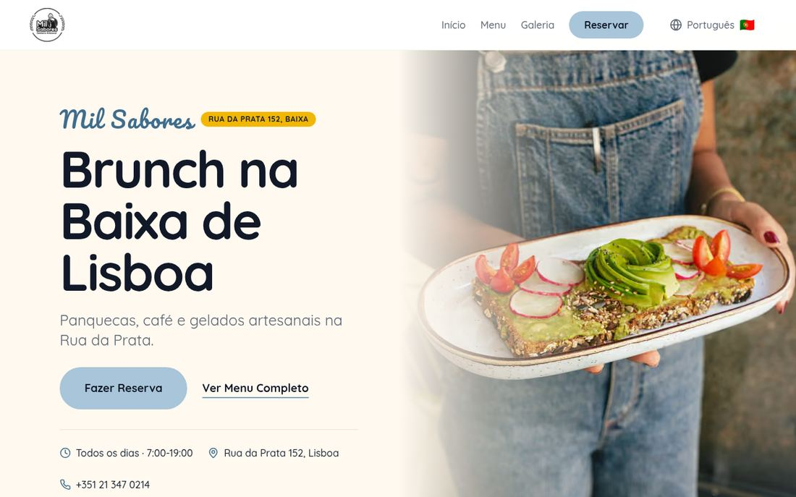
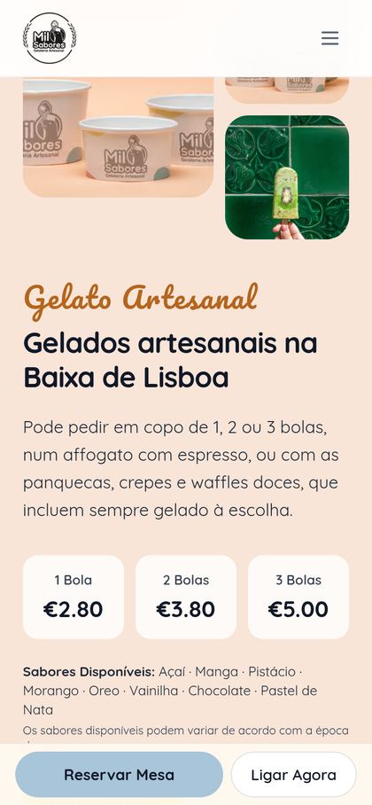
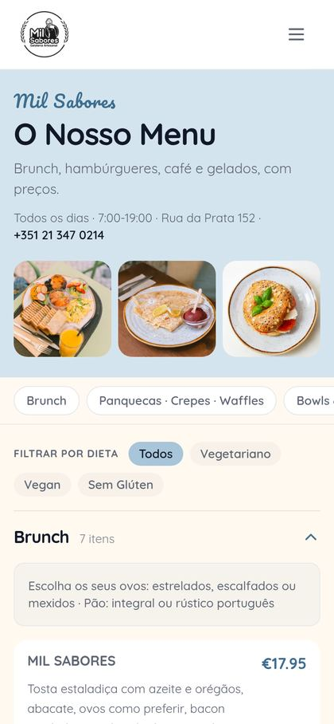
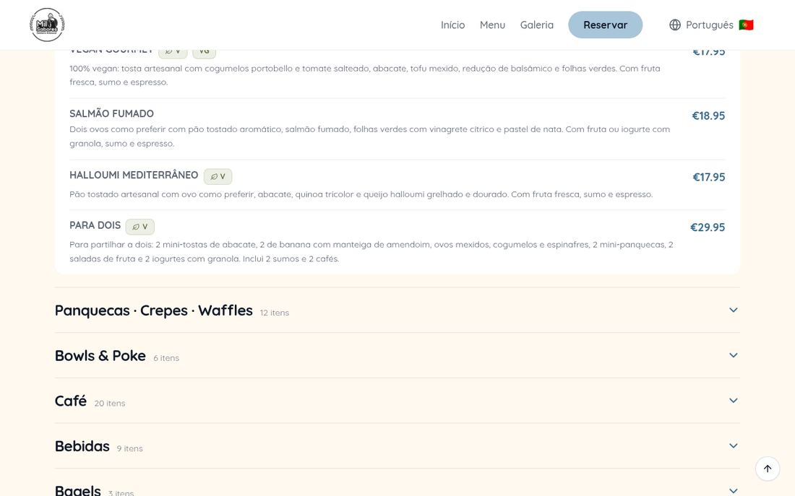
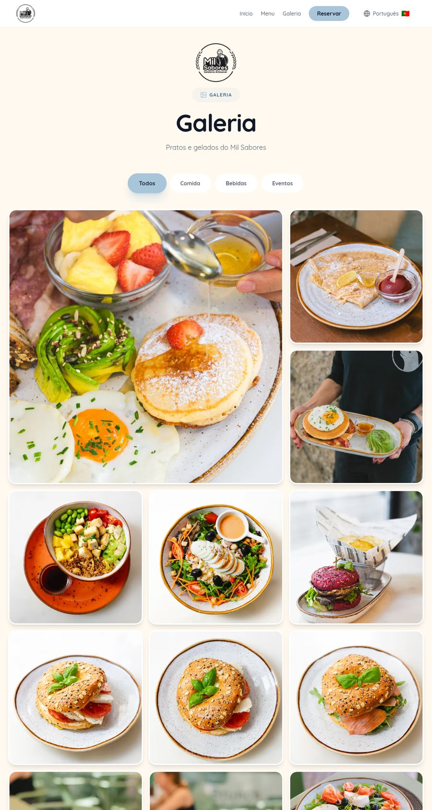
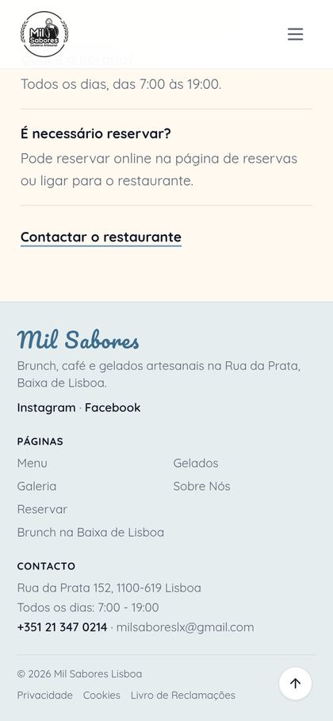

# Posible mejora: web completa Mil Sabores (propuesta "captador")

> **Estado: propuesta NO aplicada, en pausa por decisión de José (8/11/2026).**
> José: "Creo que no tocaré la web temporalmente, déjalo en memoria GitHub de posible mejora y listo".
> Esta rama **no se ha fusionado** y **no hay PR**. La web en vivo (www.milsaboresbrunch.com) y `main` no se han tocado.

- Preview (sin indexar): https://milsabores-propuesta-captador.vercel.app
  - Es un proyecto de Vercel aparte, `milsabores-propuesta-captador`, no el de producción.
- Rama: `propuesta/captador-web-completa`, creada a partir de `main` en el commit `df8fda0`.
- Nota de memoria del caso: [human-webs-mega › memory/CASES/MIL-SABORES-PROPUESTA-APARCADA-2026-11-08.md](https://github.com/josetabares24-png/human-webs-mega/blob/main/memory/CASES/MIL-SABORES-PROPUESTA-APARCADA-2026-11-08.md)
- Detalle completo:
  - [CAMBIOS-WEB-COMPLETA.md](./CAMBIOS-WEB-COMPLETA.md): cambios ronda a ronda.
  - [AUDITORIA-ESTETICA.md](./AUDITORIA-ESTETICA.md): puntuaciones por página.

## ⚠️ Antes de fusionar: quitar el bloqueo de buscadores (noindex)

La rama lleva un bloqueo para que el preview no se indexe. Está limitado a los dominios que **no** son el de producción, así que si se fusiona por error, `www.milsaboresbrunch.com` sigue indexable. Lo comprobé en local con `next start` simulando cada dominio:
- En `*.vercel.app` responde `X-Robots-Tag: noindex, nofollow` y `Disallow: /`.
- En `www.milsaboresbrunch.com` no envía cabecera noindex y sirve el robots.txt original (`Allow: /`, `Disallow: /api/`, sitemap).

Aun así, **hay que quitarlo antes de fusionar**:
1. `next.config.ts`: borrar la segunda entrada de `headers()`, la marcada "PROPUESTA (quitar antes de fusionar)", la que tiene `missing: host`.
2. `src/app/robots.ts`: volver a la versión original de `main`, la estática con `allow: '/'` y `disallow: ['/api/']`.

## Qué cambia (resumen por ronda)

**Ronda 2: web completa**
- Colores de marca según `brand/BRAND-MEMORY.md`:
  - Azul pastel #A8C5D9 como color principal, fondo crema #FFF9F0.
  - Mango, sage y peach solo como acentos. Fuera el negro/amarillo y el morado/rosa de Instagram.
  - Fuente Quicksand, y Pacifico solo en detalles.
- Textos que sonaban a IA reescritos en los 6 idiomas (pt, es, en, fr, de, it).
- SEO:
  - Title y description únicos por página e idioma, un solo H1 por página.
  - Alt traducidos, JSON-LD desde `src/config/restaurant.ts`.
  - Canonical a `https://www.milsaboresbrunch.com`.
- Las cabeceras ya no empiezan invisibles hasta la animación, lo que mejora el LCP (tiempo de carga de lo principal).

**Ronda 3: menos "plantilla"**
- Banner de cookies en una franja fina.
- Barra móvil "Reservar Mesa / Ligar Agora" fina, que nunca coincide con el banner.
- Fuera los iconos en tarjetas de colores, las etiquetas encima de cada título, el logo repetido, el 3D y los brillos.
- Títulos concretos, y "Links Rápidos" pasa a "Páginas".

**Ronda 4: auditoría estética**
- Vuelve la vida que la ronda 3 había quitado:
  - Bandas de color alternas: crema, pastel, blanco, peach y sage.
  - Toques de Pacifico.
  - Fotos grandes de platos y sección propia de gelados en peach/mango.
  - Mosaico de Instagram.
  - Aparición suave al hacer scroll.
- Media del inicio: 2,9 → 4,1 sobre 5.

**Ronda 5: menú y pie**
- Menú:
  - Cabecera corta con banda pastel, 3 fotos y botones de categoría.
  - Categorías como filas de texto con líneas finas, sin fotos en los desplegables.
- Pie de página compacto: unos 490 px en móvil, antes más de 750.
- La barra móvil se esconde al llegar al pie.

**Rondas 6 y 7: galería e inicio**
- La galería vuelve al diseño de la ronda 2.
- La rejilla no deja huecos: las 6 primeras fotos con prioridad, fondo pastel mientras cargan y se oculta el filtro "Interior" vacío.
- Fuera del inicio el bloque de 3 puntos ("Ingredientes frescos / Carta Variada / Na Baixa").

## Lo que José aprobó o rechazó

| Tema | Decisión de José |
|---|---|
| Azul pastel como color principal (no amarillo/negro) | Aprobado |
| Banner de cookies fino y barra de reservar fina | Aprobado ("ocupaba demasiado espacio") |
| Quitar el aspecto "IA"/plantilla | Aprobado, pero sin dejar la web aburrida (ronda 4) |
| Dirección visual de la ronda 4 (color, fotos, gelados) | Le gusta |
| Fotos dentro de los desplegables del menú | **Rechazado**: quitadas |
| Cabecera del menú de la ronda 4 | **Rechazado** ("no quedó bonito"): rehecha en la ronda 5 |
| Pie de página alto | **Rechazado**: compactado |
| Galería de la ronda 3 | **Rechazado**: vuelve a la de la ronda 2 |
| Huecos o tarjetas en blanco en la galería | **Rechazado** ("No dejes espacios vacíos"): corregido |
| Bloque de 3 puntos en el inicio | **Rechazado**: quitado |
| Aplicar la propuesta a la web en vivo | **En pausa** (8/11/2026) |

## Preguntas abiertas para José (antes de publicar)
1. **Gelados**: la web dice "feito diariamente no nosso espaço, sem conservantes nem corantes artificiais". ¿Es cierto? Si no, se quita.
2. **Vista a la Igreja de São Nicolau** (sección Visite-nos): ¿se confirma?
3. **Política de reservas**: "cancelación gratis hasta 24 h" y "mesa guardada 15 minutos". ¿Siguen vigentes con resmio?
4. **Promociones 13:00–18:00** (imperial a 1,50 €, cócteles a 5 €, hamburguesa + patatas a 10/12 €): ¿siguen vigentes?
5. **Español**: ¿se unifica todo como "helados/tortitas"? Ahora se mezcla con "gelados/panquecas".

## Pasos para aplicarla
1. Responder las preguntas abiertas y ajustar los textos (`messages/*.json`).
2. Quitar el bloqueo noindex/robots (ver arriba).
3. Revisar el NAP (nombre, dirección, teléfono) y el horario contra la ficha de Google Business Profile. Hoy la web dice:
   - Mil Sabores Lisboa
   - Rua da Prata 152, 1100-619 Lisboa
   - +351 21 347 0214
   - Todos los días 07:00–19:00
4. Comprobar que el dominio bueno es `www.milsaboresbrunch.com`: canonical, hreflang, sitemap y JSON-LD. `brunchmilsabores.com` no existe.
5. Actualizar la rama con `main` (`git rebase main`), `npm run build`, revisar el preview de Vercel y fusionar con una PR revisada.
6. Después de publicar: comprobar en Search Console que se indexa y que `robots.txt` está bien.

## Capturas (preview, noviembre 2026)
| | |
|---|---|
| Inicio, escritorio |  |
| Inicio, móvil (gelados) |  |
| Menú, móvil |  |
| Menú, escritorio (categorías) |  |
| Galería, escritorio |  |
| Pie, móvil |  |

## Archivos principales tocados
- Componentes nuevos:
  - `src/components/GelatoBand.tsx`
  - `src/components/MobileReserveBar.tsx`
  - `src/components/Reveal.tsx`
- Componentes modificados: Hero, Navigation, About, FeaturedDish, MenuSection, InstagramGallery, HomeSeoSections, VisitSection, Footer, CookieConsent, BackToTop, IntentPage.
- Páginas: inicio, menu, galeria, reservas, brunch-lisboa, cookies, privacidad, error, not-found.
- Textos: `messages/{pt,es,en,fr,de,it}.json`.
  - Scripts de reescritura: `scripts/copy_rewrite.py` y `scripts/copy_rewrite_v3.py`.
- Marca: `brand/*.md`, con el dominio corregido a milsaboresbrunch.com.
